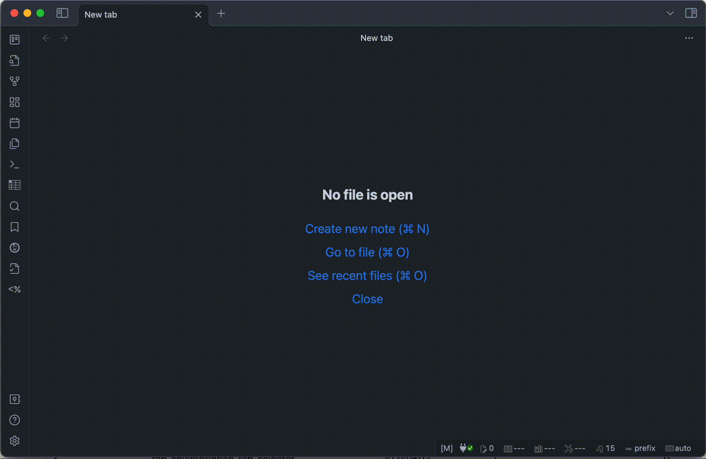

# Command Tracker

An [Obsidian](https://obsidian.md/) plugin that tracks the number of times the command is used.

This plugin helps optimize the plugins and hotkeys used.  
You can check the date of last use of each command and how much times each command is used daily.

- If you find a command you use frequently from the command palette, you may want to assign a hotkey to it.
- If a hotkey which a command assigned is rarely used, you may want to consider ceding the hotkey to another command (or uninstall the target plugin).

## How to use

1. When a command is executed, this plugin records it.
1. Run the `Command Tracker: Open view` command to view the recorded information.

> [!NOTE]
>
> - Supported: The following command execution methods.
>   - Use hotkeys.
>   - Select from command palette.
> - Not supported: Other command execution methods.
>   - Example, select from the Ribbon, execute by UI operation and etc...
> - Known bugs:
>   - When you restart Obsidian with the `Command Tracker` tab open, the hotkeys don't appear in the table.
>     - If you close and reopen the `Command Tracker` tab, the hotkeys will appear in the table.
>   - When you open the `Command Tracker` tab without a keyboard connected, the hotkeys don't appear in the table.
>     - After connecting a keyboard, close and reopen the `Command Tracker` tab to show the hotkeys.

> [!TIP]
>
> - Location of recorded data
>   - The history of command usage is recorded in [IndexedDB](https://developer.mozilla.org/en-US/docs/Web/API/IndexedDB_API/Basic_Terminology).

> [!CAUTION]
>
> - Data of “Command Tracker” is deleted in the following cases.
>   - All data is deleted in the following cases.
>     - When the "Delete all data" operation in the settings.
>     - When this plugin is updated, disabled or uninstalled. (You can protect data in the settings on desktop. Not available on mobile.)
>   - Some data is deleted in the following cases.
>     - When the number of records exceeds the configured maximum (default 2000) and a new record is written, the oldest record is deleted.
>     - When a new record is written, records that have exceeded the retention period set from the date of use (default 60 days) are deleted.

## Installation

You can find and install this plugin through Obsidian’s Community Plugins Browser.  
For detailed steps or alternative installation methods, click [here](https://github.com/namikaze-40p/obsidian-command-tracker/blob/main/docs/installation.md).
